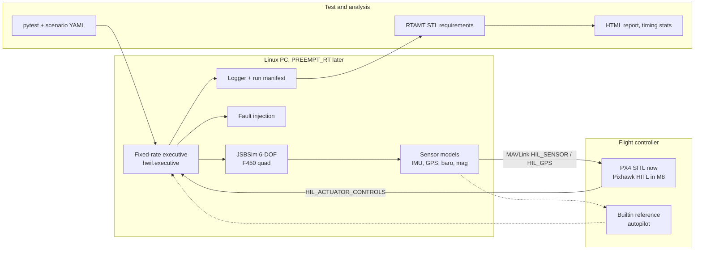

# Open HWIL Testbed

A small, fully open-source, **unclassified hardware-in-the-loop (HWIL) testbed**
for a home bench: a fixed-rate simulation on Linux (JSBSim 6-DOF flight model,
sensor models, fault injection) with a real flight controller in the loop over
MAVLink, plus automated, requirement-style tests graded with signal temporal
logic (RTAMT).

The vehicle is a small, generic, civilian quadcopter (the public JSBSim F450
model). The flight controller is PX4: PX4 SITL first, then a real Pixhawk in
HITL mode.

> **Status:** M0 (repo, license, ground rules) and M1 (software-in-the-loop
> loop, one command per scenario, logs and plots) are done. PX4 v1.15.4 SITL
> flies both scenarios through the MAVLink HIL bridge in lockstep and passes
> the same STL requirements as the builtin controller.
> Next: M2 (test harness), then the rest of the software-only milestones. See [Milestones](#milestones).

## Ground rules

These are non-negotiable for every file, issue and pull request in this repo.

- **Civilian and generic.** The vehicle is a small fixed-wing UAV or quadcopter
  using public models. No weapons, guidance-to-target, seeker or engagement
  content.
- **No employer material.** No code, data, models, documents or know-how
  specific to any employer or program. Everything comes from public sources and
  is written fresh.
- **Public by design.** Assume everything here is published. Contributors get
  any employer outside-activity or public-release approval they need before
  contributing.
- **Export control.** Stay with public, general-purpose material. When in
  doubt, leave it out.
- **Not for flight.** This is a test and learning bench. It is not certified,
  not safety-critical, and not for flying real aircraft.

## Quick start (software in the loop, no hardware)

Needs Linux (or macOS) and **Python 3.10 to 3.12** (RTAMT does not run on 3.13 yet).

```bash
git clone https://github.com/jstumfoll2/open-hwil-testbed
cd open-hwil-testbed
python3.12 -m venv .venv && . .venv/bin/activate
pip install -e ".[dev]"

hwil run scenarios/takeoff_hold_land.yaml     # about 4 s of wall time
pytest                                        # about 15 s; PX4 tests skip without PX4
```

`hwil run` prints a summary and writes a run folder under `runs/`:

| File | What it holds |
|---|---|
| `manifest.json` | git commit and dirty flag, config hash, seed, package versions, kernel and PREEMPT_RT flag, the fully resolved scenario, results, SHA-256 of every output |
| `log.csv` | one row per frame: state, commanded altitude, motor commands, wind, sensor values |
| `timing.csv` | per-frame lateness, compute time, controller I/O wait, overrun flag |
| `flight.png`, `motors.png`, `timing.png` | plots |
| `report.html` | summary, requirement results with robustness margins, plots, manifest |

Re-run any run from its manifest alone and check that it matches:

```bash
hwil reproduce runs/<run>/manifest.json
```

Builtin-controller runs in the default `afap` clock are deterministic, so the
re-run's log is bit-identical (the SHA-256 in the manifest must match).

## With PX4 SITL in the loop

Build PX4 once (see [docs/setup.md](docs/setup.md)), then:

```bash
PX4_DIR=~/src/PX4-Autopilot ci/run_px4_sitl.sh > px4.log 2>&1 &
hwil run scenarios/takeoff_hold_land.yaml --controller px4
```

The testbed listens on TCP 4560. PX4 connects, receives `HIL_SENSOR` and
`HIL_GPS`, and answers with `HIL_ACTUATOR_CONTROLS`. Arm, takeoff and land are
sent as normal MAVLink commands on UDP 14540. The same scenario and the same
requirements grade both controllers. To include PX4 in the test suite:

```bash
HWIL_PX4_DIR=~/src/PX4-Autopilot pytest -m px4
```

## How it fits together



More in [docs/architecture.md](docs/architecture.md).

## Scenarios and requirements

A scenario is one YAML file with initial conditions, wind and turbulence,
sensor noise, a mission (`takeoff`, `hold`, `land`), timed faults (motor
efficiency loss, GPS dropout, baro bias) and requirements written in STL:

```yaml
requirements:
  - id: REQ-ALT-001
    text: After 30 s, altitude stays within 5 m of the commanded loiter altitude while loitering.
    stl: "eventually[30s,30s](always((loiter > 0) -> (abs(alt_m - alt_cmd_m) <= 5.0)))"
```

Each requirement passes when its robustness is positive, and the robustness is
the margin in the spec's units. Format details: [docs/scenarios.md](docs/scenarios.md).

## Known limitations

- The builtin controller reads true state, not the sensor models. It tests the
  simulation plumbing; PX4 is the controller that exercises the sensors.
- The F450 model's landing gear is simplified. With PX4 in the loop, a takeoff
  in a steady wind above about 6 m/s with moderate turbulence can tip the
  vehicle over on the ground before liftoff, and the run aborts with
  "simulation diverged". Airborne, both controllers handle stronger wind.
- Drag is one isotropic term; there is no rotor drag, ground effect or
  propeller inflow model yet.
- HITL over serial is wired into the bridge but not yet tested on a Pixhawk.
- Python frame timing on a stock (non-RT) kernel shows occasional overruns: a
  107 s realtime run on a shared cloud VM had 35 overruns of 26,780 frames
  (worst start lateness 10.7 ms at a 4 ms period). That is the baseline M4 and M7 have
  to beat.

## Repo layout

```
open-hwil-testbed/
  README.md          goals, ground rules, quick start
  LICENSE            Apache-2.0
  docs/              brief, architecture, setup guide, scenario format
  hwil/              Python package: executive, JSBSim wrapper, sensors,
                     builtin controller, MAVLink bridge (hwil/bridge),
                     manifest, requirements grading, reports, CLI
  executive/         reserved for the C++ / NASA Trick executive (M4, M6)
  models/            JSBSim model overlays (F450 drag), later sensor FMUs
  scenarios/         YAML scenario files
  tests/             pytest suite, including RTAMT-graded scenario tests
  tools/             helper scripts (log tools, anomaly detection in M5)
  ci/                scripts used by CI and the bench (PX4 SITL launcher)
  .github/workflows/ GitHub Actions (SIL tests on every push)
```

## Milestones

Reordered on 2026-11-09: everything that needs no hardware comes first
(M2 to M6), so the project keeps moving before the bench exists. The hardware
milestones (M7, M8) reuse all of it unchanged.

| # | Milestone | Needs hardware | Done when | Status |
|---|---|---|---|---|
| M0 | Repo, license, README, ground rules | no | Public repo exists with the brief | done |
| M1 | SIL loop: JSBSim + PX4 SITL, scripted takeoff/loiter/land | no | One command runs a scenario and produces plots | done |
| M2 | Test harness | no | 10+ scenarios with STL-graded requirements, an HTML report per run and a suite report, for both builtin and PX4 SITL | in progress |
| M3 | Monte Carlo in SIL | no | Batch runs over wind, sensor-noise and fault dispersions, in parallel, with pass-rate and margin statistics | |
| M4 | Compiled executive and timing tooling | no | C++ fixed-rate loop with JSBSim, same scenarios and logs as Python; jitter and overrun report on a stock kernel; bridge latency measured in SITL | |
| M5 | AI-in-test add-on | no | Anomaly detection over run logs, plus LLM-drafted test cases reviewed by a human | |
| M6 | NASA Trick executive (optional) | no | Trick runs the loop with Monte Carlo of wind and sensor-noise cases in SIL | |
| M7 | Real-time baseline on PREEMPT_RT | Linux PC | cyclictest and in-loop jitter report; no overruns in a 30-minute run | overrun counter and timing log in place |
| M8 | HITL with a real Pixhawk | Pixhawk | Same scenarios pass in SIL and HITL within stated tolerances; end-to-end latency measured | serial-link option in the bridge, untested |
| M9 | Write-up | no | Blog post or paper draft on lab engineering lessons | |

The full project brief is in [docs/brief.md](docs/brief.md).

## License

Apache License 2.0, see [LICENSE](LICENSE). JSBSim and its aircraft data
(LGPL-2.1), PX4 (BSD-3-Clause), pymavlink (LGPL-3.0) and RTAMT (BSD-3-Clause)
are used as external dependencies under their own licenses and are not copied
into this repo.
